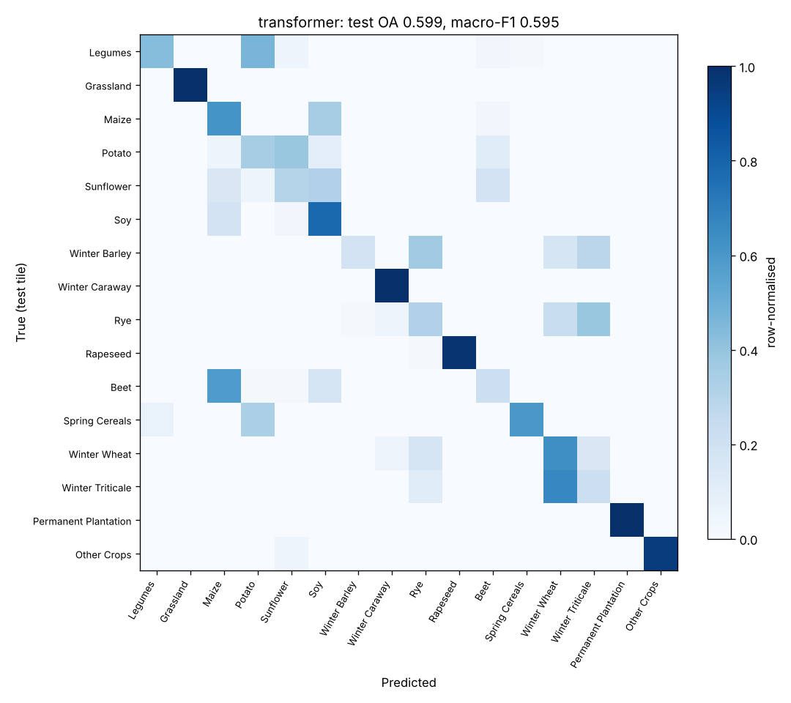
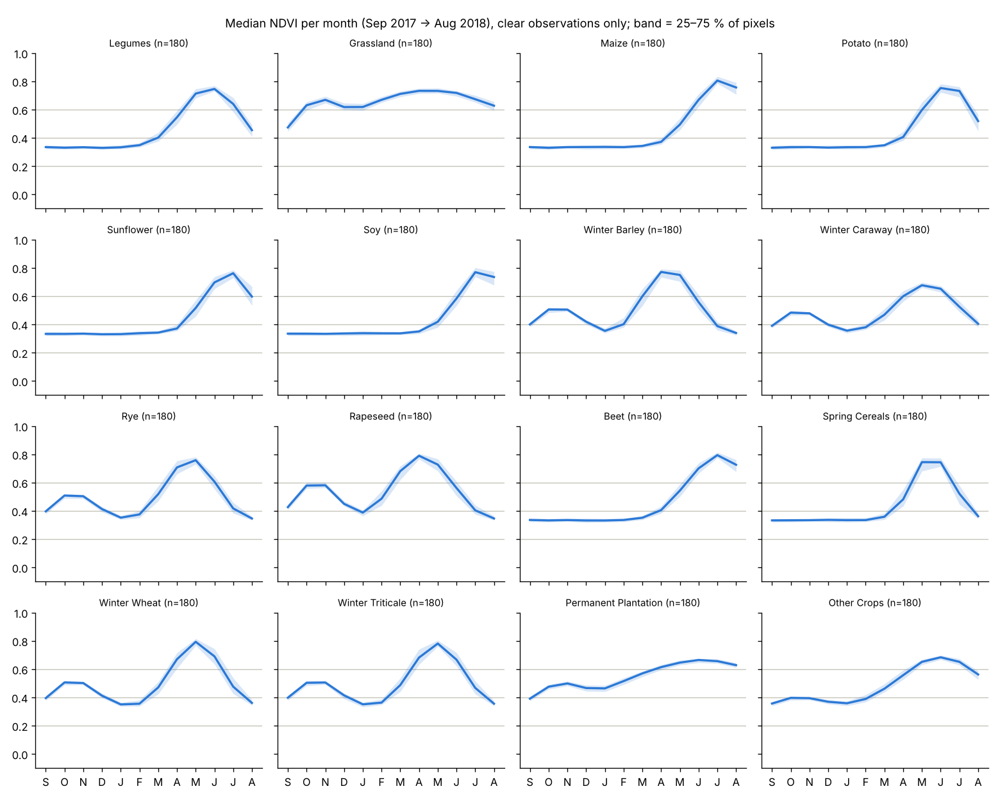

# Crop-Type Classification & Vegetation Monitoring with Sentinel-2 Time Series

[](https://github.com/Vb-777/timesen2crop-classification/actions/workflows/tests.yml)

Classifies **16 crop types** in Austria from **Sentinel-2 satellite time series** (the [TimeSen2Crop](https://zenodo.org/records/4715631) benchmark, about 1 million labelled pixels) with three deep sequence models (**TempCNN, Transformer, class-weighted LSTM**) and a Random Forest baseline. It also tracks crop growth stages through the season with **NDVI**.

Course project for **CS-540 Advanced Cyber-Physical Systems, IIT Ropar (Jan–May 2024)**, guided by Dr. Neeraj Goel and Dr. Mukesh Saini.
Team: Vaibhav Barsaiyan, Sravan S Sankar, Shubham Thawait.

> **Version 2 (2026).** A review of the 2024 code found that it predicted the cloud/shadow/snow *flag* instead of the crop, and that its test scores were not measured on held-out data. This repository is a corrected re-implementation. The original notebooks, report and slides are kept in [`legacy/`](legacy), and every issue and its fix is documented in [`legacy/ISSUES.md`](legacy/ISSUES.md).

## Method

```
raw pixel CSVs ──► mask cloud / shadow / snow ──► 12 monthly median composites (Sep 2017 → Aug 2018)
 (irregular dates,     (Flag ≠ 0 dropped)          × 9 bands (B2–B7, B8A, B11, B12)
  per tile)                                         + "month observed" mask channel
                                              │
          normalise with TRAIN-tile statistics ┘
                                              │
   train on 13 tiles ──► pick best epoch on validation tile 33TWN ──► score test tile 33UVP once
```

- **Spatially independent split.** The test tile shares no area with the training tiles, so the score measures generalisation to a new region (the dataset's official protocol).
- **Models** (PyTorch):
  - **TempCNN**: three 1-D convolution blocks over time (Pelletier et al., 2019).
  - **Transformer**: self-attention encoder over 12 monthly tokens, with positional encoding.
  - **LSTM** and **weighted LSTM**: the same network; the weighted version uses a class-balanced loss for the heavily imbalanced crops.
  - **Random Forest**: classical baseline on the flattened 12 × 10 features.
- **Metrics:** overall accuracy, Cohen's κ, macro- and weighted-F1, per-class precision/recall/F1, and a confusion matrix.
- **NDVI** = (B8A − B4) / (B8A + B4) on clear observations only. The output is a median monthly phenology curve per crop, with an interquartile band, plus vegetation-density classes.

## Results

> **To fill in after running on the real data.** The dataset is about 1 million CSV files and couldn't be downloaded in the environment where v2 was written. Run the commands below; `results/RESULTS.md` is generated automatically.

| Model | Test OA | κ | Macro-F1 |
|---|---|---|---|
| TempCNN | – | – | – |
| Transformer | – | – | – |
| LSTM | – | – | – |
| Weighted LSTM | – | – | – |
| Random Forest | – | – | – |
| *Dataset paper (same split): TempCNN / LSTM / Transformer / weighted LSTM* | *81.7 / 83.4 / 84.4 / 85.4 %* | | |

A demo run on **synthetic** data in the same file format is in [`docs/demo-synthetic/`](docs/demo-synthetic). It shows what the outputs look like, not real accuracy.

<p>
  
  
</p>

## Quick start

```bash
git clone https://github.com/Vb-777/timesen2crop-classification.git
cd timesen2crop-classification
pip install -e .                 # numpy, scikit-learn, matplotlib, torch

# 1. try the whole pipeline on synthetic data (about 1 minute on a laptop CPU)
python -m cropclf synth --out data/synthetic
python -m cropclf prepare --root data/synthetic --cache cache/synthetic
python -m cropclf benchmark --cache cache/synthetic --out results/synthetic --epochs 25
```

### On the real TimeSen2Crop data

Download TimeSen2Crop from [Zenodo](https://zenodo.org/records/4715631). Either layout works:

- **As downloaded,** `TimeSen2Crop/<tile>/<crop 0–15>/<n>.csv`: the official split is applied automatically (validation 33TWN, test 33UVP, the remaining 2017/18 tiles for training; the 2019 folder is ignored).
- **Already split,** `TimeSen2Crop/{train,validate,test}/<tile>/…`

Then:

```bash
python -m cropclf prepare  --root /path/to/TimeSen2Crop --cache cache/full --workers 16   # once; reads ~1 M files
python -m cropclf benchmark --cache cache/full --out results                             # GPU used automatically
python -m cropclf ndvi     --root /path/to/TimeSen2Crop --split test --out results/ndvi
```

For a quick first run, add `--max-per-class 2000` to `prepare`. That samples up to 2,000 pixels per crop per tile. On the full training set (about 800 k pixels) the Random Forest is the slowest step; add `--models tempcnn transformer lstm weighted-lstm` to `benchmark` to skip it.

### Tests

```bash
pip install -e ".[dev]" && pytest
```

The 14 tests cover cloud masking, compositing, labels coming from the crop folder (never the flag), train-only normalisation, class weights, metrics, the model shapes, end-to-end learning above chance with the test tile kept separate, both dataset layouts, and NDVI. They run on every push through GitHub Actions.

## Repository layout

```
cropclf/
  data.py      loading, cloud masking, monthly compositing, train-only normalisation
  models.py    TempCNN, LSTM, Transformer (PyTorch)
  train.py     training with early stopping on the validation tile, one-shot test evaluation, plots
  ndvi.py      NDVI phenology and vegetation-density classes
  synth.py     synthetic data in the TimeSen2Crop file format (tests and demo)
  cli.py       python -m cropclf {synth, prepare, train, benchmark, ndvi}
tests/         pytest suite
legacy/        the 2024 course submission (notebooks, report, slides) and ISSUES.md
docs/          synthetic demo outputs
```

## Notes and limitations

- The class order follows the dataset description (folder `0` = Legumes … `15` = Other Crops). Check it against Table I of the dataset paper for your copy of the data.
- Months with no clear observation are filled with the training mean and flagged in the mask channel. The dataset paper fills them with zeros, which may cause small differences from its numbers.
- The 2019 tile included in TimeSen2Crop is not used. Training on 2017/18 and testing on 2019 would be a natural *temporal* domain-shift experiment.

## References

1. G. Weikmann, C. Paris, L. Bruzzone, "TimeSen2Crop: A Million Labeled Samples Dataset of Sentinel 2 Image Time Series for Crop-Type Classification," *IEEE JSTARS*, vol. 14, pp. 4699–4708, 2021.
2. C. Pelletier, G. I. Webb, F. Petitjean, "Temporal Convolutional Neural Network for the Classification of Satellite Image Time Series," *Remote Sensing*, 11(5), 523, 2019.
3. M. Rußwurm, M. Körner, "Self-attention for raw optical Satellite Time Series Classification," *ISPRS J. Photogramm. Remote Sens.*, 169, 421–435, 2020.
